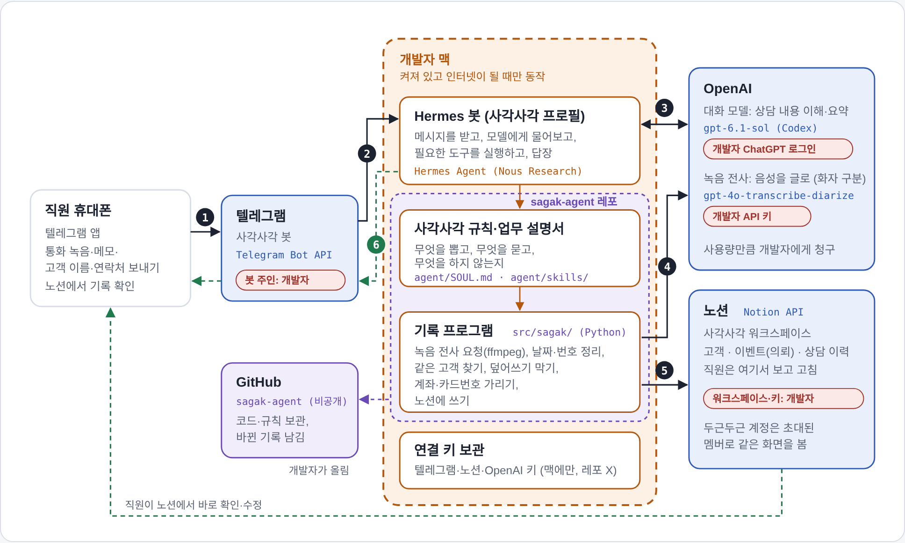

# 사각사각 (sagak-agent)

이벤트 회사의 전화 상담 녹음(또는 전사 텍스트)과 고객 정보를 텔레그램으로 받아,
Notion 고객 관리 보드에 요구 사항과 상담 이력을 정리하는 Hermes Agent 기반 에이전트입니다.
AX School 프로젝트 제출용 레포입니다.

- 상태: 녹음·전사 텍스트·채팅 내보내기 → Notion 기록 동작, 개발자 PC에서 테스트 운영 중 (다음: 클라우드 이전)
- 기획안: [docs/planning.md](docs/planning.md)
- 개발 계획서: [docs/dev-plan.md](docs/dev-plan.md)
- 서비스 흐름: [docs/service-flow.md](docs/service-flow.md)
- 결정 기록: [docs/decisions.md](docs/decisions.md)

## 서비스 흐름

<picture>
  <source media="(prefers-color-scheme: dark)" srcset="docs/images/service-flow-dark.png">
  
</picture>

1. 직원이 텔레그램 봇에 통화 녹음(또는 메모)과 고객 이름·연락처를 보냅니다.
2. 개발자 PC의 Hermes 봇(profile `sagak`)이 받습니다.
3. OpenAI 대화 모델이 규칙(`agent/`)에 따라 내용을 정리합니다.
4. 녹음이면 OpenAI 전사 모델로 글로 옮깁니다.
5. 기록 프로그램(`src/sagak/`)이 노션 고객·이벤트·상담 이력에 씁니다.
6. 봇이 확인 필요 항목과 노션 링크를 답장합니다.

단계별 담당 파일, 쓰는 모델과 도구, 지금 테스트 구성의 한계와 클라우드 이전 계획은 [서비스 흐름 문서](docs/service-flow.md)에 있습니다.

## 폴더 구조

```
sagak/
├── README.md
├── CLAUDE.md          Claude 작업 규칙 (Karpathy 가이드라인 + 프로젝트 규칙)
├── docs/              기획안, 개발 계획서, 결정 기록
├── src/               Python 코드 (전사, 검증, Notion 동기화)
├── agent/             Hermes profile `sagak` 파일 (SOUL.md, skills, 설정 예시)
├── recordings/        로컬 실제 녹음·전사 (커밋 안 됨)
└── tests/fixtures/    가상 테스트 데이터 (커밋 가능)
```

## 실행과 테스트

업체별 값(접수 브랜드, 상품명과 고객 안내 이름)은 `agent/business.json`에 둡니다. 레포에는 예시 `agent/business.example.json`만 있으니 복사해서 고쳐 쓰세요(실제 파일은 커밋되지 않음).

```bash
python3 -m unittest discover -s tests -t .           # 단위 테스트 (표준 라이브러리만 사용)
PYTHONPATH=src python3 -m sagak check tests/fixtures/extractions/s01.json   # 검증만
PYTHONPATH=src python3 -m sagak ping                 # Notion 접근 확인 (sagak profile 환경변수 필요)
PYTHONPATH=src python3 -m sagak announce --dry-run   # 봇 변경 안내 미리 보기 (--dry-run 빼면 텔레그램 발송 + [/new] 버튼)
PYTHONPATH=src python3 -m sagak console              # 개발자 PC 브라우저에서 안내 편집·미리 보기·보내기
```

봇에서는 `agent/skills/sagak-intake` 스킬이 `python3 -m sagak record`를 호출합니다.

## 원칙

- API 키, 봇 토큰, 실제 고객 데이터는 커밋하지 않습니다. 키는 Hermes 대시보드에서만 입력합니다.
- 녹음과 고객 정보에 없는 내용은 추측하지 않고 `확인 필요`로 표시합니다.
- 기존 고객 정보는 덮어쓰지 않고, 상담은 매번 새 이력으로 추가합니다.

## 개발 흐름

개발자 PC에 설치한 Hermes에서 profile `sagak`으로 개발하고, 운영은 컨테이너(개발자 PC → 클라우드)로 옮깁니다.
자세한 단계는 [개발 계획서](docs/dev-plan.md)를 보세요.
