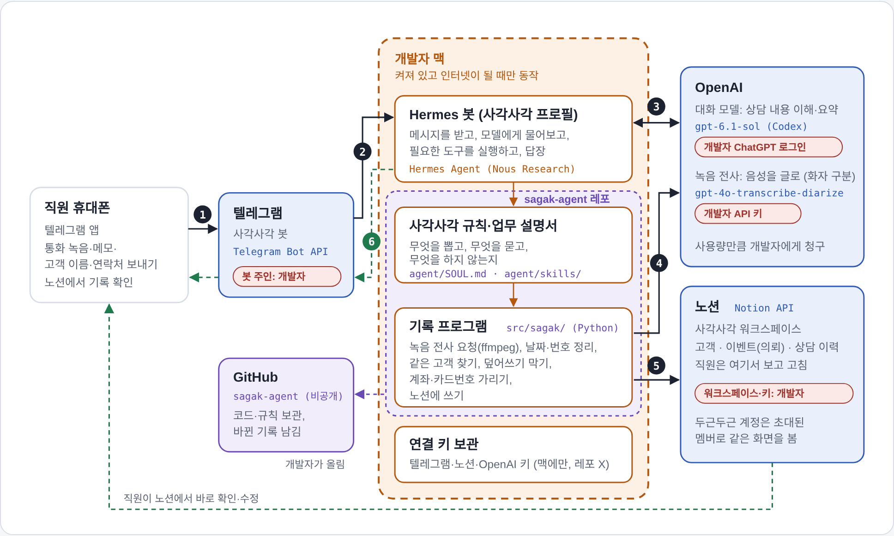

# 서비스 흐름

직원이 텔레그램으로 통화 녹음이나 메모를 보내면, 개발자 PC에서 돌아가는 봇이 내용을 정리해 노션의 고객·이벤트·상담 이력에 적고 링크를 답장합니다.
지금은 테스트 구성이라 개발자 PC와 개발자 계정을 빌려 쓰고 있습니다.

<picture>
  <source media="(prefers-color-scheme: dark)" srcset="images/service-flow-dark.png">
  
</picture>

그림 읽는 법

- 주황 점선: 개발자 PC 안에서 돌아가는 부분 (켜져 있고 인터넷이 될 때만 동작)
- 보라 점선: 이 레포(`sagak-agent`)에서 오는 코드와 규칙
- 파란 상자: 바깥 서비스 (텔레그램, OpenAI, 노션)
- 빨간 표시: 지금은 개발자 계정을 임시로 사용

## 메시지 한 건이 노션에 오기까지

| 단계 | 하는 일 | 어디서 | 레포에서 담당 |
|---|---|---|---|
| 1. 직원이 보낸다 | 통화 녹음(또는 상담 메모·채팅 내보내기)과 고객 이름·연락처를 텔레그램 봇에 보냄 | 텔레그램 | — |
| 2. 봇이 받는다 | 텔레그램이 개발자 PC에서 대기 중인 Hermes 봇(profile `sagak`)에게 넘김. 허용된 직원의 메시지만 받음 | 개발자 PC | `agent/config.example.yaml` (프로필 설정 예시) |
| 3. 모델이 내용을 이해한다 | 사각사각 규칙에 따라 OpenAI 대화 모델에게 묻고 희망 일시·장소·예산·요청 사항·확인할 점을 뽑음 | OpenAI | `agent/SOUL.md`, `agent/skills/sagak-intake/SKILL.md` |
| 4. 녹음이면 글로 옮긴다 | OpenAI 전사 모델로 시각·화자가 붙은 글로 바꿈. 형식이 맞지 않으면 ffmpeg로 변환. 메모로 보내면 건너뜀 | OpenAI | `src/sagak/transcribe.py` |
| 5. 프로그램이 노션에 쓴다 | 같은 고객 찾기, 기존 값 덮어쓰지 않기, 계좌·카드번호 가리기, 날짜·상품명 맞추기 후 고객·이벤트·상담 이력에 기록 | 개발자 PC → 노션 | `src/sagak/record.py`, `sync.py`, `notion.py` |
| 6. 링크를 답장한다 | "기록 완료", 확인 필요 항목, 노션 링크를 텔레그램으로 답장. 직원은 노션에서 보고 고침 | 개발자 PC → 텔레그램 | `agent/skills/sagak-intake/SKILL.md` (답장 형식) |

판단(무엇을 뽑고 어떻게 답할지)은 모델이 규칙 문서를 읽고 하고, 기록 규칙(덮어쓰기 금지, 번호 가리기, 고객 연결)은 코드가 항상 지킵니다.

## 쓰는 모델과 도구

| 구분 | 이름 | 비고 |
|---|---|---|
| 에이전트 실행기 | Hermes Agent (Nous Research) | 따로 설치. 이 레포는 그 위에 얹는 프로필·스킬·코드 |
| 대화 모델 | OpenAI gpt-6.1-sol (Codex 연결) | ChatGPT 로그인으로 연결 |
| 녹음 전사 | OpenAI gpt-4o-transcribe-diarize | 화자 구분. `SAGAK_STT_MODEL`로 교체 가능 (OpenAI 종료 예고 2027-02) |
| 메신저 | Telegram Bot API | |
| 기록 | Notion API | |
| 기록 프로그램 | Python 표준 라이브러리, ffmpeg | 외부 패키지 없음 |

업체마다 다른 값(접수 브랜드, 상품명과 고객 안내 이름)은 `agent/business.json`에 두고 커밋하지 않습니다. 형식은 `agent/business.example.json`을 보세요.

## 지금은 테스트 구성

**개발자 PC가 꺼지면 봇도 멈춥니다.**

- 봇은 개발자 PC 안에서 돌아갑니다. PC가 꺼지거나 잠자기, 인터넷이 끊기면 메시지를 받지 못합니다.
- 그동안 보낸 메시지는 PC가 다시 켜졌을 때 처리되거나 다시 보내야 할 수 있습니다.
- 기능을 고치면 봇을 다시 시작해야 해서 잠깐 멈출 수 있습니다.

**개발자 계정을 빌려 쓰고 있습니다.**

- 대화 모델: 개발자의 ChatGPT 로그인
- 녹음 전사: 개발자의 OpenAI API 키 (사용량만큼 개발자에게 청구)
- 노션 워크스페이스와 연결 키, 텔레그램 봇: 개발자가 만든 것
- 고객 이름·연락처·통화 음성이 이 계정들을 거쳐 갑니다.

키와 토큰은 개발자 PC의 프로필 `.env`에만 있고 이 레포에는 없습니다.

## 클라우드로 옮기면

개발자 PC 안에 있는 부분(주황 점선)을 그대로 클라우드 서버로 옮기면 누구의 컴퓨터와도 상관없이 24시간 돌아갑니다. 이때 계정도 고객사 명의로 바꾸면 비용과 데이터가 고객사 것이 됩니다.

| | 지금 (개발자 PC) | 클라우드로 옮긴 뒤 |
|---|---|---|
| 돌아가는 시간 | PC가 켜져 있을 때만 | 24시간 |
| 멈추는 경우 | PC 종료·잠자기·인터넷 끊김·수정 중 재시작 | 서버 점검 때 잠깐 |
| 모델·전사 계정 | 개발자 계정 | 고객사 명의 계정으로 교체 |
| 노션·텔레그램 봇 | 개발자가 만든 것 | 고객사 소유로 옮김 |
| 코드·규칙 | 개발자 PC의 이 레포 폴더 | 같은 레포를 서버에 올려 실행 |
| 직원이 쓰는 방법 | 텔레그램으로 보내고 노션에서 확인 | 똑같음 |
